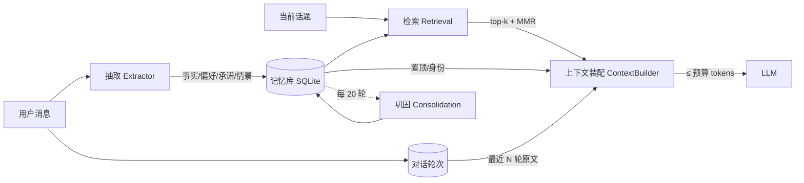

# Companion AI Memory

> 借鉴人脑的记忆分层、遗忘曲线与睡眠巩固，把"越聊越贵"的上下文压缩成一个小而稳的记忆包：
> **同样记得住，token 只要零头。**

`caim`（Companion AI Memory）是一个零依赖、可离线运行的 Python 记忆引擎，给陪伴型 AI / 长期对话 Agent 用。
它不替换你的模型，只负责一件事：**在有限的上下文预算里，装进"此刻最该被想起"的记忆。**

```
全量历史   2,768 tokens  ──┐
滑动窗口     264 tokens  ──┤   CAIM: 279 tokens，关键事实 12/12
                           └─► 省 90%，且不失忆
```

---

## 一、它解决什么问题

长期陪伴型对话有三个绕不过去的矛盾：

| 做法 | 代价 |
| --- | --- |
| 把全部历史塞进上下文 | token 线性增长，几周后直接撞上下文上限 |
| 只保留最近 N 轮 | 便宜，但**失忆**：上周说过的过敏、生日、约定全没了 |
| 简单摘要 | 摘要会漂移、丢细节，且每次都要重算，成本高 |

人脑给出的答案是**分层 + 遗忘 + 巩固**：不是记住一切，而是把"重要的"沉淀成结构化记忆，
把"不重要的"自然衰减掉，需要时再按线索检索回工作记忆。

CAIM 把这套机制工程化：

| 人脑机制 | CAIM 实现 | 代码 |
| --- | --- | --- |
| 工作记忆（容量极小） | 按预算装配的上下文字符串 | `context.py` |
| 情景记忆 | `EVENT`：某轮发生的事，带时间戳 | `models.py` |
| 语义记忆 | `FACT` / `PREFERENCE`：实体化事实 | `extract.py` |
| 自我图式 | `PROFILE`：名字、身份，置顶 | `models.py` |
| 意图记忆 | `PROMISE`：承诺、待办 | `extract.py` |
| 艾宾浩斯遗忘 | 强度随时间指数衰减，重要性决定半衰期 | `decay.py` |
| 间隔重复 | 每次被召回 → 强度上升、衰减重置 | `decay.py` |
| 睡眠巩固 | 定期去重、情景压缩成语义、修剪低价值记忆 | `consolidate.py` |
| 线索依赖回忆 | 查询相关性 + 近因 + 重要性 + 强度的混合打分 | `retrieval.py` |
| 侧抑制 / 去冗余 | MMR 多样性重排，相似记忆不重复占位 | `retrieval.py` |

---

## 二、架构



装配顺序即优先级，**每一段都有独立预算上限，任何一段都饿不死别的段**：

1. 系统约束（固定，约 40 tokens）
2. 核心档案（置顶 / 身份，≤28%）
3. 长期记忆（检索结果，≤50%）
4. 最近对话原文（剩余预算，最少保证 1 轮）

---

## 三、快速开始

```bash
git clone <your-repo-url> Companion-AI-Memory-Context-Token-Optimization
cd Companion-AI-Memory-Context-Token-Optimization
pip install -e .

caim demo     # 看一段 22 天的对话如何被压缩
caim bench    # 跑合成基准：全量 vs 窗口 vs CAIM
```

不装包也能跑：

```bash
PYTHONPATH=src python -m caim demo
```

### 接进自己的对话循环

```python
from caim import MemoryEngine

engine = MemoryEngine("companion.db", budget_tokens=1200)

# 每轮对话：写入 + 抽取
engine.add_turn("我对花生过敏，别给我推荐带花生的", "记住了，以后避开花生")

# 下一轮：拿上下文，而不是把历史全塞进去
ctx = engine.build_context("晚上想点外卖，有什么推荐？")
print(ctx.text)
# 【核心档案】
# - 用户要求记住：我喝东西不喝冰的，胃不好
# - 用户的名字是阿瑞
# 【长期记忆】
# - 用户对花生过敏
# ...

resp = llm.chat(system=ctx.text, user="晚上想点外卖，有什么推荐？")
engine.add_turn("晚上想点外卖，有什么推荐？", resp)
```

`ctx` 还带可观测字段：`ctx.tokens`、`ctx.sections`（各段实际占用）、`ctx.memory_ids`、
`ctx.dropped`（被预算挤掉的候选数）、`ctx.summary()`（一行摘要）。

---

## 四、实测数据

> 合成对话、埋 12 条关键事实（名字/生日/过敏/宠物/城市/职业/恐惧/乐队/妹妹/忌口/约定），
> 对话结束后用 12 个探针问题逐条检查"上下文里还在不在"。
> 全部可复现：`caim bench --turns 120 --budget 1200`。

**120 轮对话，预算 1200：**

| 策略 | 平均上下文 tokens | 相对全量节省 | 关键事实保留 |
| --- | ---: | ---: | ---: |
| 全量历史 | 2,768 | 0% | 12/12（100%） |
| 滑动窗口（最近 10 轮） | 264 | 90% | 0/12（0%） |
| **CAIM** | **279** | **90%** | **12/12（100%）** |

**规模越大，优势越明显（预算 800）：**

| 对话轮数 | 全量历史 | CAIM | 节省 | 事实保留 |
| ---: | ---: | ---: | ---: | ---: |
| 120 | 2,768 | 279 | 90% | 12/12 |
| 400 | 9,069 | 280 | 97% | 12/12 |
| 1000 | 22,570 | 280 | 99% | 12/12 |

**巩固的贡献（400 轮，budget=800）：**

| 巩固 | 记忆条数 | 存储 tokens | 事实保留 |
| --- | ---: | ---: | ---: |
| 开 | 31 | 426 | 12/12 |
| 关 | 402 | 4,605 | 12/12 |

巩固把**长期存储**压掉 91%，且不损失关键事实——它压在"存储侧"，不占用对话时的上下文。

> 说明：这是**合成基准**，不是 LLM 打分的主观评测；token 用本项目估算器（中文 1 字 ≈ 0.95 token），
> 与真实分词器有 ±15% 误差。完整方法与局限见 [docs/BENCHMARK.md](docs/BENCHMARK.md)。

---

## 五、关键设计

### 1. 遗忘曲线：重要的事忘得慢

```python
retention = strength * 0.5 ** (静默天数 / half_life)
half_life = 2 + 40 * importance ** 1.5      # 2 天 ~ 42 天
```

- 闲聊（importance≈0.3）半衰期约 8 天，一个月后基本想不起来；
- 过敏/生日（importance≈0.95）半衰期约 39 天，一年后仍有 ~0.001 —— 但每次提到都会
  被"间隔重复"增强，实际远高于此；
- **置顶记忆永不遗忘**：用户说"记住……"就是显式的"这件事很重要"。

### 2. 检索：四个因子 + 去冗余

```
score = 0.55·相关性 + 0.12·近因 + 0.23·重要性 + 0.10·强度
```

近因权重刻意压低：**最近几轮本来就以原文进上下文**，长时记忆更该拼"相关"和"重要"，
否则闲聊会把真正的事实挤出预算。相关性用字符二元组 + 同义词扩展（讨厌≈不喜欢≈不吃），
中文不需要分词器。

### 3. 装配：预算硬约束

- 任何一段都不会超过自己的配额，预算极小时也不会崩（有最小保证）；
- 已经装进"核心档案"的记忆不会再出现在"长期记忆"里；
- 预算是天花板不是目标：相关记忆装完就停，**不为填满预算而塞噪声**。

### 4. 巩固：像睡觉一样整理

每 20 轮自动触发一次（也可手动 `engine.consolidate()`）：

- **去重**：相似度 > 0.85 的记忆合并，保留信息更全、更强的一条；
- **情景 → 语义**：4 条同类情景压成 1 条"阶段纪要"，可反复压缩；
- **修剪**：有效强度低于 0.06 且不重要的情景记忆删除，置顶/身份永不修剪。

---

## 六、可观测性

陪伴产品最怕"它到底记不记得"说不清。CAIM 把每个决策都暴露出来：

```python
result = engine.build_context("我有什么忌口？")
result.summary()
# '279/1200 tokens（rules 46t，profile 26t，longterm 118t，recent 84t），记忆 14 条'
```

```python
for hit in engine.retrieve("花生"):
    print(hit.explain())
# 用户对花生过敏  (score=0.86 rel=0.40 rec=0.02 imp=0.95 str=1.00)
```

维护者还能看到：`engine.stats()`（各类记忆条数、存储 token、置顶数）、
`consolidate()` 的返回报告（合并/压缩/修剪了多少条、省了多少 token）。

---

## 七、目录结构

```
.
├── src/caim/
│   ├── models.py       # 记忆条目与类型
│   ├── store.py        # SQLite 持久化
│   ├── extract.py      # 规则抽取（可换 LLM）
│   ├── decay.py        # 遗忘曲线 / 间隔重复
│   ├── retrieval.py    # 混合打分 + MMR
│   ├── consolidate.py  # 去重 / 压缩 / 修剪
│   ├── context.py      # 预算化上下文装配
│   ├── pipeline.py     # MemoryEngine 门面
│   ├── benchmark.py    # 合成基准
│   └── cli.py          # demo / bench / stats
├── tests/              # 54 个单元测试
├── benchmarks/         # 预算扫描与消融脚本
└── docs/               # 设计说明与基准报告
```

---

## 八、局限与路线图

**已知局限**

- 规则抽取只覆盖常见中文表达，复杂句、隐喻、方言会漏；→ 实现 `Extractor` 协议接 LLM 即可增强；
- 相关性是词面匹配，不做语义向量；→ `retrieval.relevance` 可替换为 embedding 余弦；
- 合成基准只验证"关键词是否还在"，不等于"模型能否正确回答"；
- token 估算有 ±15% 误差，需要精确计费请装 `caim[tiktoken]`。

**路线图**

- [ ] LLM 抽取器示例（一次性抽取 + JSON schema 校验）
- [ ] embedding 检索后端（可选，保持零依赖默认）
- [ ] 记忆冲突检测（"我搬家了"应覆盖旧城市）
- [ ] 时间线问答（"我们第一次聊到豆豆是什么时候"）
- [ ] 与 AstrBot / LangBot 的适配插件

---

## 九、发布到 GitHub

仓库已按开源项目整理好（`LICENSE` / `.gitignore` / `pyproject.toml` / CI 模板），
本机装好 git 后：

```bash
git init
git add .
git commit -m "feat: CAIM 记忆引擎初版"
git branch -M main
git remote add origin https://github.com/<你的账号>/Companion-AI-Memory-Context-Token-Optimization.git
git push -u origin main
```

> 想改名的话：`Companion-AI-Memory-Context-Token-OptimizationPublic` 末尾的 `Public`
> 看起来是 GitHub 仓库页上的可见性标签，已按干净的项目名创建；若要保留原名，
> 直接重命名文件夹并在 GitHub 建同名仓库即可。

## 十、开发

```bash
pip install -e .
python -m unittest discover -s tests -v   # 54 tests
python benchmarks/run_benchmark.py --sweep
```

CI 模板在 [`docs/ci.yml.example`](docs/ci.yml.example)，复制到 `.github/workflows/ci.yml` 即可启用：

```bash
mkdir -p .github/workflows && cp docs/ci.yml.example .github/workflows/ci.yml
```

MIT License.
